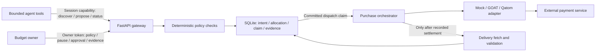

# Mandate backend architecture

Mandate is a single-tenant hackathon payment gateway. An agent proposes a bounded
purchase; deterministic rules and a durable ledger control whether the executor
may contact a payment rail. This document describes main after PR #3. Features
still in review are listed separately and are not represented as deployed.

## Authority and data flow

The diagram separates application responsibilities, not operating-system security
domains. The repository does not yet enforce a separate agent OS account, network
namespace, filesystem or secret store. The model callback is trusted code supplied
by its caller. Do not run untrusted agent code with executor credentials or a
shared home directory/environment; isolated-executor acceptance remains MND-03.

`backend/agent/runner.py` offers only discovery, proposal and status, with step,
deadline and unique-request bounds. AgentGateway sends a session capability and
removes inherited owner/auth/cookie headers from requests. The model's text cannot
authorize an owner route. This API restriction does not prevent an independently
privileged process from reading files or making network calls.

Owner HTTP routes use X-Owner-Token and fail closed if unconfigured. Agent routes
use X-Session-Key. Session tokens are returned once and only their SHA-256 digest
is stored. Active/frozen/revoked state is checked again in ledger transactions.
Revocation is terminal. The kill-switch revokes active and frozen keys atomically;
resume never restores those credentials. The owner is trusted and can change
future mandate policy. No multi-owner or multi-tenant authorization is claimed.

## Exact money and durable execution

Internal money is integer thousandths of USD-TDN, bounded by JavaScript's safe
integer limit. Purchase JSON uses decimal strings; explicitly named amount_milli
and balance fields use integer units. For a six-decimal token, 40 milli maps
exactly to the base-unit string "40000". Booleans, fractional/unsafe integers and
nonpositive purchase amounts are refused before reservation.

A request fingerprint binds the mandate, agent, normalized seller/address, item,
amount and complete tool-call envelope. Reusing a request key with changed input
is refused. A matching replay returns the stored purchase; it cannot create a
second dispatch claim. Trusted Python bootstrap/test callers may omit session IDs
or expected policy versions; those helpers are not exposed as unauthenticated
HTTP capabilities.

Ledger mutations use BEGIN IMMEDIATE transactions. Reservations, balances and
their evidence commit together. The budget invariant is available + held + settled
= allocation. Policy/authority and optional owner-recorded wallet checks are
repeated inside claim acquisition. Owner policy HTTP writes require an exact
expected_version; stale updates fail without changing policy or evidence.

```mermaid
stateDiagram-v2
    [*] --> PROPOSED
    PROPOSED --> BLOCKED: Hard denial; no rail call
    PROPOSED --> PENDING_APPROVAL: Hold and review
    PROPOSED --> RESERVED: Automatic authorization and hold
    PENDING_APPROVAL --> RESERVED: Valid owner approval and recheck
    PENDING_APPROVAL --> REJECTED: Owner rejects; release hold
    PENDING_APPROVAL --> EXPIRED: Review expires; release hold
    RESERVED --> DISPATCHED: Durable unique claim before remote send
    DISPATCHED --> SETTLED: Rail reports payment
    DISPATCHED --> RECOVERY_UNKNOWN: Ambiguous result or interrupted dispatch
    DISPATCHED --> EXPIRED: Definitively unpaid
    RECOVERY_UNKNOWN --> SETTLED: Original transaction established
    RECOVERY_UNKNOWN --> EXPIRED: Definitive no-payment evidence
    SETTLED --> VERIFIED: Delivery passes validation
    SETTLED --> RECOVERY_UNDELIVERED: Delivery missing or invalid
    RECOVERY_UNDELIVERED --> VERIFIED: Delivery-only recovery
```

A durable claim proves local intent to send, not that a provider received or paid
the order. A crash after the claim, even before the actual send, requires cautious
recovery; it never authorizes blind resubmission. Timeouts retain the hold. Missing
lookup identity requires operator investigation. An amount or wallet balance
alone does not establish which payment occurred.

Pause prevents new claims after acknowledgment. It cannot cancel a claim/payment
already in flight, reverse a payment or stop its accounting. Settlement and
reconciliation of existing exposure remain allowed while paused. Resume requires
locally reconciled dispatched/unknown exposure and no configured wallet mismatch.
Wallet snapshots are supplied by the owner; they are not a live provider oracle.

## Rail and delivery assumptions

MockRail is a deterministic fixture and never moves real money. GOAT order
creation/payment terms are not settlement. The main GOAT adapter's normalized
responses still need observed live challenge/status/identity verification; payer
authorization is not established by signing an order request. A stored order ID
does not independently prove the amount, recipient, chain or finality.

Qatom's adapter and observed two-step approval contract are present after PR #3.
The provider offers no client idempotency key. Its pending approval context is
currently held in memory, so restart can lose it. Exact durable human authorization
and provider approval/resume binding remain the protected MND-10 work. Opening an
approval link alone must never be treated as completed authorization. This pass
does not independently validate a new live transaction on either rail.

Settlement is recorded before delivery is fetched. JSON shape, complete UTF-8
payload size, item/request/original-order correlation, timestamps and optional
exact price metadata are validated separately. Paid-but-undelivered remains spent;
delivery retry does not issue a second checkout. Structural validation does not
prove the commercial quality or truth of a seller's data. The controlled seller
catalog and mock payloads are synthetic fixtures.

## Evidence and trust limits

Events have contiguous sequence numbers, previous/event hashes, policy hashes and
purchase references. SQLite triggers prohibit application UPDATE/DELETE. The
verifier reports the first broken link. A database administrator can remove those
guards and recompute the entire local chain: hash links alone are not immutability,
nonrepudiation or independent proof of payment. Purchase-filtered event snippets
are not a complete independently rehashable chain.

MND-13 PR #5 adds periodic local HMAC checkpoints and comparison with an externally
retained artifact. It remains in review at this document's baseline. Independent
retention and key-ring/rotation management are deferred; compromise of both the
database and symmetric signing key defeats that model. MND-17 PR #4 supplies the
short-lived browser stream grant; streams remain read-only synchronization, not
financial authority. No frontend implementation is part of this ticket.

## Verification and pending work

From mandate: `python -m pytest backend/tests -q` and
`python -m ruff check backend scripts`. Use isolated disposable databases and mock
rails for destructive tests. Existing suites exercise accounting, idempotency,
policy/session controls, crash recovery, delivery and tampering. The additional
independent-connection/process proof matrix is in MND-23 PR #8; it is not claimed
merged here. MND-27 PR #7 makes UNKNOWN a failing CLI exit and prints stored mock
purchase details; default main still has the earlier five-scenario CLI behavior.

No production-readiness, zero-fraud, universal prompt-injection detection, refund,
multi-region availability or regulatory-compliance guarantee is made. See
[SECURITY.md](../SECURITY.md) for the threat model and operational limits. MND-22/provider attack
acceptance remains with its assigned owner; no protected rail or approval/reconcile
path was edited in this documentation pass.
